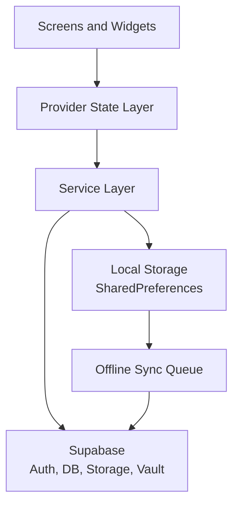

# CrimiReview

CrimiReview is a Flutter app for Criminology board exam preparation: adaptive quiz practice driven by Bayesian Knowledge Tracing, an admin panel for managing question content, progress tracking, daily challenges, flashcards, and cloud sync via Supabase.

## Current App Flow (August 2026)

### Launch and Routing

```text
App start
	-> Initialize services (storage, supabase, admin role check, notifications, feedback, ML, connectivity, offline sync)
	-> Splash
	-> Onboarding check
	-> Auth check
	-> Onboarding / Auth / Home
```

### Authentication

- Sign up: a 6-digit email code (generated, verified, and emailed entirely server-side — see **Security** below), then the Supabase account is created and signed in.
- Sign in merges local and cloud progress and handles account switching on shared devices.
- Forgot password: the same server-side code flow, then a Supabase RPC (`reset_user_password`) applies the new password.
- **Continue with Google** (`lib/services/social_auth_service.dart`): Supabase OAuth with PKCE in the phone's browser, back into the app through `com.crimireview.crimireview://login-callback`. A Google login with the same email as an existing account opens that same account. It is offered as a Google icon under the sign-in form ("or continue with", `social_sign_in_icons.dart`). The icon is always there (Android, iPhone, web); until Google is switched on in Supabase, tapping it says "Google sign-in isn't available yet. Please sign in with your email." It never appears inside the student or admin screens. Facebook sign-in was removed on 2026-10-17. Setup: **Google sign-in** below.
- Every sign-in method finishes through `PostSignInService` (cloud/local merge, account switching, admin routing).
- **Dashboard setting required:** Authentication → Providers → Email → turn **off** "Confirm email". This app's own code-verification step replaces Supabase's built-in confirmation email; leaving both on causes sign-in to fail right after a successful signup.

### Main Navigation

Five tabs (students): a bottom bar on phones, a side navigation rail on tablets in landscape and computers (840 px wide and up); the Home dashboard switches to two columns from about 1000 px. Text follows the phone's text-size setting up to 130%.

- **Home** (`dashboard_view.dart`): greeting, streak and leaderboard; **today's goal** (questions answered today against a goal the student picks: 10/20/30/50) with this week's study days; **continue learning** (most recent subject at the level and segment the student is on, one tap to start); Daily Challenge with a "done today" state; totals; board-exam readiness from the ML model; **topics to review** (lowest BKT mastery); shortcuts; study modules.
- **Quiz:** subjects → difficulty lock/unlock → study notes → quiz → results. Item selection goes through `QuestionSelectionService` (unseen-first, weighted toward weak topics per the BKT model in `MasteryService`) so a retry never repeats the same set.
- **Cards:** `FlashcardsHomeScreen` (subject picker) → `FlashcardScreen` (swipe-to-review deck for that subject), both reading from `QuestionRepository`.
- **Progress:** stats, streak, subject breakdown, achievements entry.
- **Settings:** theme, notifications/sound/haptics, profile, password, sign in/out.

**Admin Panel** *(an account with `role = 'admin'` lands here instead of the student tabs)*: its own shell — a bottom bar on phones, a side navigation rail on tablets/desktop/web — with a dashboard of content and student stats, question bank CRUD and template generation, and a read-only student mastery monitor. See `supabase_schema_v2.sql` section 13 for how to promote an account.

## Architecture Overview



Layer summary:

- **UI:** screens and reusable widgets in `lib/screens` and `lib/widgets`, including `lib/screens/admin/` for the admin panel.
- **State:** Provider-managed notifiers for adaptive learning, theme, connectivity, and offline sync.
- **Services:** business logic for auth, storage, quiz logic, ML, notifications, and email verification. Content-specific services:
  - `QuestionRepository` — the single source of every quiz question (Supabase `public.questions`, with an offline SharedPreferences snapshot). There is **no hardcoded question content anywhere in this app.**
  - `QuestionSelectionService` — picks which questions a learner sees next: unseen-first, weighted toward the topics with the lowest modeled mastery, recycling least-seen items only once a pool is exhausted.
  - `MasteryService` — Bayesian Knowledge Tracing (Corbett & Anderson, 1995) per-topic learner model; decides whether a topic is mastered or needs to repeat.
  - `ExplanationService` — guarantees a wrong answer always comes with a specific, non-empty reason.
  - `AdminService` — question CRUD, student mastery overview, audit log; gated by the same `is_admin()` function the database's row-level security uses.
- **Data:** local persistence in SharedPreferences and cloud persistence in Supabase (Postgres + Auth + Storage + Vault for secrets).
- **Sync:** offline operations are queued locally and flushed when connectivity is restored.

## Design system

The whole UI (student app and admin panel) is built from one design system, introduced in the 2026-10 redesign:

- **Brand:** the logo's black, red and white (since Session 48). The logo's red (`#D7101F`, dark mode `#E8192C`) is the interactive colour (buttons, links, tabs). Hero cards go from that red to black, greys are neutral, and the splash screen is the logo's black with a red glow. A quiz answer that has been tapped but not yet checked shows in ink (black/white), never red, so it can't be mistaken for "wrong". Gold still marks points, ranks and achievements; green / amber / red still mean right / so-so / wrong. Each board subject keeps its own accent colour (`AppColors.subjectColors`).
- **Tokens:** `lib/services/theme_service.dart` defines `AppPalette` (light and dark colour sets), spacing/radii (`AppSpace`) and the full Material 3 theme. Screens read colours with `context.palette` instead of hard-coding them, so dark mode comes from one place.
- **Typeface:** Plus Jakarta Sans, bundled in `assets/fonts/` (SIL Open Font License), so text renders correctly even on a first launch offline.
- **Components:** `lib/widgets/ui/` — import `widgets/ui/ui.dart` to get `AppCard`, `GradientCard`, `StatTile`, `PageHeader`/`SectionHeader`/`AppTopBar`, `PrimaryButton`/`SecondaryButton`, `AppTextField`, `CodeInput`, `PillTabs`, `Pill`, `IconBadge`, `InlineBanner`, `AppListGroup`, `RingProgress`, `AppProgressBar`, `EmptyState`, `LoadingView`, `UserAvatar`, `showConfirmDialog` and `showAppSnack`.
- **Logo:** the source is `assets/icon/logo_original.png`. `lib/widgets/app_logo.dart` shows it on a black rounded tile (`assets/images/logo_mark.png`, cropped close to the artwork) next to the wordmark ("Crimi" in ink, "Review" in red, like the logo's C and R). App icons for Android, iOS, Windows and macOS come from `assets/icon/app_icon.png` via `dart run flutter_launcher_icons` (settings in `pubspec.yaml`). Web icons, the favicon and the website's logo are made from the same source.

## Setup on New Laptop (Windows)

### 1. Install Flutter SDK

```bash
# Download Flutter SDK
https://docs.flutter.dev/get-started/install/windows

# Extract to C:\flutter

# Add to System PATH:
C:\flutter\bin
```

### 2. Install Android SDK (Command Line Only)

```bash
# Download Command Line Tools from:
https://developer.android.com/studio#command-line-tools-only

# Extract to C:\Android\cmdline-tools\latest

# Add to System PATH:
C:\Android\cmdline-tools\latest\bin
C:\Android\platform-tools

# Install required SDK components:
sdkmanager "platform-tools" "platforms;android-34" "build-tools;34.0.0"

# Accept licenses:
flutter doctor --android-licenses
```

### 3. Set Environment Variables

```bash
# Add these to System Environment Variables:
ANDROID_HOME = C:\Android
ANDROID_SDK_ROOT = C:\Android
```

### 4. Verify Setup

```bash
flutter doctor
```

All checks should pass.

## Run Locally

```bash
cd crimireview
flutter pub get
flutter run
```

Optional:

```bash
# Run tests (includes layout checks of the pre-login screens at 3 phone sizes, light and dark)
flutter test

# Render every screen to PNG for a design review (no phone needed)
flutter test test/screenshots --dart-define=SHOTS=build/screenshots
# ...or only some screens:
flutter test test/screenshots --dart-define=SHOTS=build/screenshots --dart-define=ONLY=home,quiz
# Responsive check: every screen on 12 devices (small/large phones, landscape,
# 7-12 inch tablets, desktop, and 130% system text); prints any layout problem
flutter test test/screenshots --dart-define=SWEEP=true
# ...add --dart-define=SHOTS=<dir> to save images of problems (ALL_IMAGES=true
# for every render) and --dart-define=DETAILS=true for which widget overflowed

# Run in release mode on connected device
flutter run --release
```

## Project Structure

```text
lib/
├── main.dart              # App entry point
├── models/                # Data models (Question, Mastery, AnswerFeedback, ...)
├── screens/                # UI screens
│   └── admin/              # Admin panel (question CRUD, student monitor)
├── services/               # Business logic — question repository, adaptive
│                            # learning (BKT), admin, auth, sync, ML
├── utils/                  # Utilities
└── widgets/                # Reusable widgets
    └── ui/                 # Design-system components (see "Design system")
assets/
├── fonts/                  # Plus Jakarta Sans (bundled typeface)
├── images/                 # In-app logo
└── ...                     # icon, ml, modules, sounds
```

There is no `lib/data/` anymore — question content used to be compiled into the app there (`questions_database.dart`, 6045 lines; `question_bank.dart`, 968 lines), which is exactly what panel note 7 flagged ("do NOT put your questions in your code"). Both files were deleted once `daily_challenge_screen.dart` and `flashcard_screen.dart` — the last two screens still reading from them — were migrated to `QuestionRepository`. Every question now lives in `public.questions` in Supabase, authored through the Admin Panel, bulk-imported, or auto-generated (see `supabase_schema_v2.sql` sections 5–6 for the generation templates).

## Supabase Setup

Project URL:

```text
https://wbhobbehgqlzfborscvx.supabase.co
```

Apply these SQL files **in this exact order**, in the Supabase SQL Editor:

1. `supabase_schema.sql` — core tables (profiles, quiz results, achievements, password reset RPC), auto-profile trigger, avatar storage bucket.
2. `supabase_email_verification.sql` — creates the `email_verifications` table (this file's own RLS policies get replaced by step 3 — leave them, they're harmless once step 3 runs).
3. **`supabase_security_fixes.sql`** — locks `email_verifications` and `password_resets` down to zero direct client access, and moves code generation/verification/emailing entirely server-side. **Read this file's own header before running it** — it requires rotating the Resend API key and storing the new one in Supabase Vault first. Skipping this file leaves both tables readable by anyone with the app's public anon key.
4. `supabase_schema_v2.sql` — the question bank (`public.questions`), the admin role + `is_admin()`, Automatic Item Generation tables, Bayesian Knowledge Tracing state (`topic_mastery`), question exposure tracking, and the admin audit log. Section 13 of this file explains how to promote your account to admin.
5. `supabase_seed_questions.sql` *(optional)* — 759 questions migrated out of the old hardcoded Dart files, ready to seed the bank so it isn't empty on first run. Regenerate with `dart run tools/export_questions_to_sql.dart` if the source files still existed — they don't anymore, so this script is now historical.
6. `supabase_admin_management.sql` — lets an existing admin promote/demote another user from inside the app (Admin Panel → Students → "⋮") instead of needing SQL Editor access every time.
7. `supabase_template_generation.sql` — the free, no-API-key "Generate from Templates" path (the only question generator in the app): one Postgres function that turns the `question_templates`/`concept_bank` data from step 4 into real questions. Works immediately after this file runs, no further setup.
8. **`supabase_security_fixes_v2.sql`** — pre-launch security fixes: profiles (emails, schools, roles) are no longer readable by other users or logged-out visitors; the leaderboard is served by `get_leaderboard()` with public fields only; daily scores are private and insert-only; password reset re-checks the emailed code; code emails are rate-limited; avatars are limited to 2 MB images; name lengths are capped. **Requires app v1.0.1 or newer** for Forgot Password and the leaderboard.
9. `supabase_enforce_email_verification.sql` — makes the database refuse to create an account unless the email passed the 6-digit check, so Supabase's public sign-up API can't be used to skip it. Google accounts are let through (Google already proved the email). **Test a new sign-up in the app right after running it**; the file has a one-line rollback. To add a user by hand afterwards, see the file's header.
10. `supabase_social_login.sql` — new accounts from Google get their real name and profile photo instead of being named after their email address.
11. **`supabase_audit_fixes.sql`** (pre-release audit, 2026-10-17):
    - a profile's email always equals the sign-in email, and "Make admin" finds accounts by their sign-in email, so a student can't get promoted in a teacher's place;
    - profile photos can only point at the student's own upload (or their Google photo);
    - a password reset signs the account out on every device;
    - the internal email functions can only be run by the database.

## Google sign-in

The app side is done; these steps switch it on. They need your own Google account, so they can't be done from code. Callback URL used below: `https://wbhobbehgqlzfborscvx.supabase.co/auth/v1/callback`.

**0. Security first.** Run `supabase_enforce_email_verification.sql` (Supabase step 9) **before** switching Google on. Supabase joins a Google login to an existing account with the same email; without step 9, someone could pre-create an email/password account for another student's Gmail (skipping the code) and later get into that student's account.

**1. Google** ([console.cloud.google.com](https://console.cloud.google.com), any project):
1. *Google Auth Platform → Branding*: app name `CrimiReview`, your support email, developer contact email. No logo (a logo makes Google review the app first). App home page `https://www.crimireview.app`, privacy policy `https://www.crimireview.app/privacy.html`, terms of service `https://www.crimireview.app/terms.html` (the pages come from the website's privacy-terms PR, which must be merged first). Under *Authorized domains* add `wbhobbehgqlzfborscvx.supabase.co` and `crimireview.app`.
2. *Audience*: External, then **Publish app**; it stays greyed out until the Branding page is complete. Until then, add your own Gmail under *Test users* to test. Only the basic `openid`, `email`, `profile` scopes are used, so no Google review is needed.
3. *Clients → Create client*: type **Web application**; *Authorized redirect URIs*: the callback URL above. Copy the **Client ID** and **Client secret**.
4. Supabase dashboard → *Authentication → Sign In / Providers → Google*: enable, paste both, save.

**2. Let the app receive the result.** Supabase → *Authentication → URL Configuration → Redirect URLs* → add `com.crimireview.crimireview://login-callback`. Without it Supabase sends students to the Site URL instead of back into the app. **Testing in Chrome (web):** also add the web address, e.g. run with `flutter run -d chrome --web-port 3000` and add `http://localhost:3000/**` (for the published web app, its own address).

**3. Check.** Sign out; on the sign-in page, tap the Google icon under the Sign in button. It now opens Google's sign-in page instead of saying it isn't available yet. Test with an email that already has a CrimiReview account; it should open the same account with the same progress.

Facebook sign-in was removed from the app on 2026-10-17. Keep the Facebook provider **switched off** in Supabase.

Core tables used by the app:

- `user_profiles` (includes `role`: `student` | `admin`)
- `quiz_results`, `user_progress`, `daily_challenge_scores`, `user_achievements`
- `password_resets`, `email_verifications` (server-side access only, see step 3 above)
- `questions`, `question_templates`, `concept_bank`, `topic_mastery`, `question_exposure`, `admin_audit_log`

## Question generation

Questions are generated only through **Admin Panel → Questions → Generate from Templates** (step 7 above). It runs entirely inside the database — no API key, no upload, no cost — and every generated item lands inactive until an admin reviews and restores it.

The old "Generate from Document" (PDF → AI) path has been removed from the app. Step 8 (`supabase_security_fixes_v2.sql`) also drops the `document_uploads` table it left behind; the separate `supabase_remove_document_generation.sql` lists the two leftovers SQL can't remove (the storage bucket and the Edge Function).

### Security notes

- The Supabase **anon key** in `lib/services/supabase_service.dart` is meant to be public — access control lives entirely in Postgres Row Level Security, not in keeping that key secret.
- The **Resend API key** must live only in Supabase Vault (`supabase_security_fixes.sql` section 0), never in Dart source. If you ever find a Resend key hardcoded in this codebase again, rotate it immediately — it's readable by anyone who decompiles the built app.
- Before `supabase_security_fixes.sql` is run on a project, `email_verifications` and `password_resets` are readable by any anonymous request. Run it before shipping a build pointed at that project.

## Build Commands

```bash
# Debug APK
flutter build apk --debug

# Release APK
flutter build apk --release

# App Bundle (for Play Store)
flutter build appbundle --release

# Clean build
flutter clean
flutter pub get
flutter build apk --release
```

APK output:

```text
build/app/outputs/flutter-apk/app-release.apk
```

### Release signing

Without a release key, `flutter build apk --release` still works, but the build prints a warning and signs with the **debug** key. That's fine for sharing an APK for testing. The **Google Play Store rejects debug-signed apps**, so before publishing there, create your own key once:

1. Create the keystore. Run this from the project folder; it asks for a password and your name:
   ```bash
   keytool -genkey -v -keystore android/app/upload-keystore.jks -keyalg RSA -keysize 2048 -validity 10000 -alias upload
   ```
2. Create `android/key.properties` with:
   ```properties
   storePassword=the password you chose
   keyPassword=the password you chose
   keyAlias=upload
   storeFile=upload-keystore.jks
   ```
3. Build again. The warning disappears and the APK/AAB is signed with your key.

Both files are already listed in `android/.gitignore`, so they are never committed. **Back them up somewhere safe.** If you lose the keystore, you can never publish an update to the same Play Store listing.
